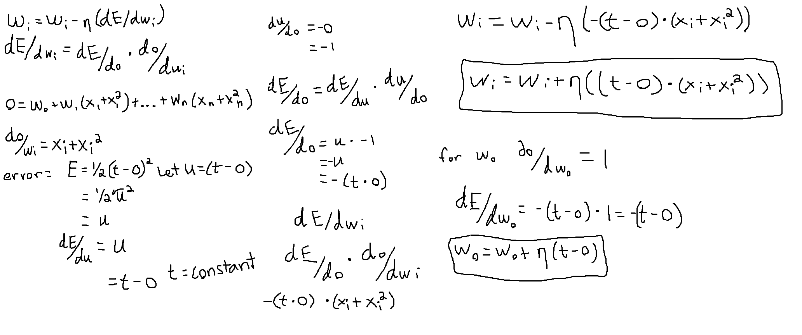
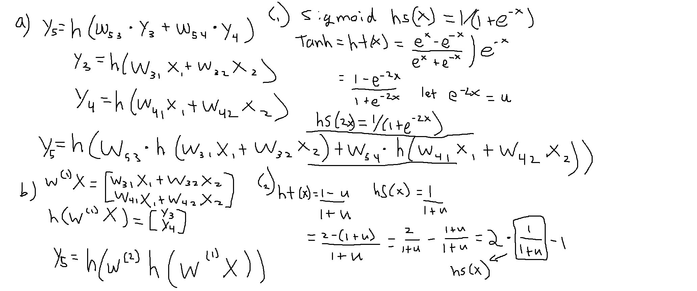
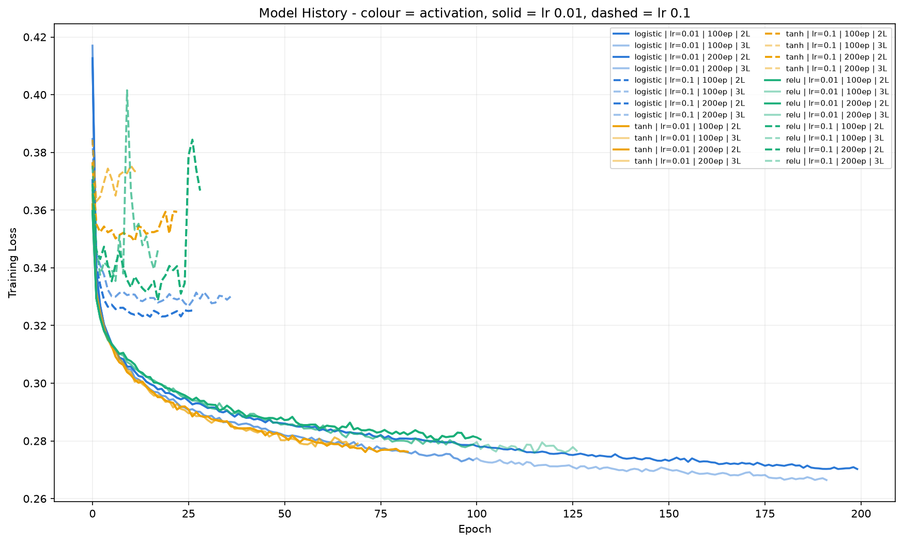

# CS 4375 — ASSIGNMENT: Neural Networks HW2

**Names of students in your group:** Ryan O'Neil

**Number of free late days used:** [2]

*Note: You are allowed a total of 4 free late days for the entire semester. You can
use at most 2 for each assignment. After that, there will be a penalty of 10% for
each late day.*

**Sources / references used in this assignment:**
- UCI Machine Learning Repository — Adult / Census Income Data Set (ID 2):
  https://archive.ics.uci.edu/dataset/2/adult
- scikit-learn documentation — MLPClassifier:
  https://scikit-learn.org/stable/modules/generated/sklearn.neural_network.MLPClassifier.html

---

# Part 1 — Theory

## 1.1 Gradient Descent
My full derivation (error, gradient descent rule, chain rule, and the two weight
update rules for the general weight and the bias) is shown below:

Final weight update rules:
- General weight: w_i <- w_i + eta (t - o)(x_i + x_i^2)
- Bias weight:    w_0 <- w_0 + eta (t - o)

## 1.2 Comparing Activation Functions
My work for parts (a), (b), and (c) is shown below:

- **(a)** y5 = h( w53 * h(w31*x1 + w32*x2) + w54 * h(w41*x1 + w42*x2) )
- **(b)** y5 = h( W2 h( W1 X ) )
- **(c)** The relationship between the two activation functions is
  ht(x) = 2 * hs(2x) - 1, so tanh is just a scaled and shifted sigmoid. [FINISH
  STEP 2: substitute this into the part (a) output and show the tanh network
  equals a sigmoid network with rescaled weights.]

---

# Part 2 — Neural Network Analysis (Programming)

## Summary of what I did
For this assignment I used the Adult / Census Income dataset to predict whether a
person makes more than 50K a year. I pulled it from UCI when the program runs and
cleaned it up: I replaced the "?" strings with NaN and dropped those rows, fixed a
label bug where the test-file labels had an extra period that was making 4 classes
instead of 2, one-hot encoded the 8 text columns into 104 number columns,
standardized the features using only the training set, and turned the target into
0/1. That left 45,222 rows. Then I used scikit-learn's MLPClassifier to train all
24 combinations of the given hyperparameters: activation (logistic/tanh/relu),
learning rate (0.01/0.1), epochs (100/200), and hidden layers (2/3), with a fixed
15 neurons per layer. For each model I saved the train/test accuracy, train/test
MSE, and the loss curve. The full pre-processing steps and my assumptions are in
the README.

One thing worth pointing out: the classes are not balanced. About 75% of the
people are <=50K, so a model that just guesses <=50K for everyone already gets
75%. That means 75% is the baseline I have to beat, not a good score.

## Results

Full results table, sorted by test accuracy:
activation  learning_rate  epochs  hidden_layers  train_acc  test_acc  train_mse  test_mse  epochs_ran
1    logistic           0.01     100              3   0.873423  0.852379   0.126577  0.147621         100
4    logistic           0.10     100              2   0.852960  0.850876   0.147040  0.149124          27
6    logistic           0.10     200              2   0.852960  0.850876   0.147040  0.149124          27
3    logistic           0.01     200              3   0.873393  0.850080   0.126607  0.149920         192
5    logistic           0.10     100              3   0.853049  0.849903   0.146951  0.150097          37
7    logistic           0.10     200              3   0.853049  0.849903   0.146951  0.150097          37
23       relu           0.10     200              3   0.852341  0.849549   0.147659  0.150451          18
21       relu           0.10     100              3   0.852341  0.849549   0.147659  0.150451          18
18       relu           0.01     200              2   0.871595  0.849284   0.128405  0.150716         102
20       relu           0.10     100              2   0.846798  0.849195   0.153202  0.150805          29
22       relu           0.10     200              2   0.846798  0.849195   0.153202  0.150805          29
16       relu           0.01     100              2   0.873187  0.845569   0.126813  0.154431         100
19       relu           0.01     200              3   0.872391  0.844330   0.127609  0.155670         127
9        tanh           0.01     100              3   0.870563  0.844065   0.129437  0.155935          70
11       tanh           0.01     200              3   0.870563  0.844065   0.129437  0.155935          70
2    logistic           0.01     200              2   0.876371  0.842473   0.123629  0.157527         200
10       tanh           0.01     200              2   0.872980  0.842473   0.127020  0.157527          83
8        tanh           0.01     100              2   0.872980  0.842473   0.127020  0.157527          83
0    logistic           0.01     100              2   0.870474  0.842385   0.129526  0.157615         100
17       relu           0.01     100              3   0.871948  0.841765   0.128052  0.158235         100
14       tanh           0.10     200              2   0.838690  0.840439   0.161310  0.159561          23
12       tanh           0.10     100              2   0.838690  0.840439   0.161310  0.159561          23
15       tanh           0.10     200              3   0.828311  0.827083   0.171689  0.172917          13
13       tanh           0.10     100              3   0.828311  0.827083   0.171689  0.172917          13

### Best Model
1    logistic           0.01     100              3   0.873423  0.852379   0.126577  0.147621         100

**Model history plot:** 

In the plot, colour is the activation (blue = logistic, orange = tanh,
green = relu), solid vs dashed is the learning rate (solid = 0.01,
dashed = 0.1), and opacity is the layer count. The most obvious thing in the
plot is that the dashed lines (lr = 0.1) bounce up and down and quit early,
while the solid lines (lr = 0.01) drop smoothly and keep going.

## 3. Analysis (What I Found)

### Which activation performed best, and why?

The "textbook" answer is that relu should win, because relu avoids the vanishing
gradient problem. But in my results all three were basically tied. Which one came
out on top actually changed with the number of neurons per layer. At 15 neurons
(the amount I used) logistic did the best, but at higher neuron counts relu did
the best. I think the reason they are all so close is that this network is really
shallow (only 2-3 layers of 15 neurons). Vanishing gradients only become a problem
in deep networks, where backpropagation multiplies a lot of small derivatives
together and the signal shrinks to almost nothing. With just 2-3 layers, sigmoid's
and tanh's main weakness never shows up, so relu's advantage does not matter here
and they all perform about the same.

### Effect of learning rate
This was the biggest effect in the whole thing. A learning rate of 0.01 beat 0.1
for every single activation. You can see why by looking at how many epochs each
one actually ran: the lr = 0.01 models ran for a long time and dropped smoothly,
while the lr = 0.1 models flattened out or jumped up and down and quit after only
about 15-35 epochs.

You can see it in the plot too. The dashed (lr = 0.1) lines zigzag up and down
instead of settling down. That is the learning rate overshooting, meaning the step
size is so big it jumps past the bottom instead of landing on it. Once the loss
stops improving, scikit-learn's early stopping kicks in and quits, so those models
end early without getting anywhere good. A couple of the lr = 0.1 models even
dropped all the way down to the 75% baseline, which means they basically stopped
learning.

### Effect of epochs (100 vs 200)
Because I set a fixed random seed (seed 42), a lot of the 100-epoch and 200-epoch
models came out exactly the same. That is because most models converged before
they even hit 100 epochs, so raising the limit to 200 did nothing. The run just
ended at the same spot either way. The epoch count only mattered for the few
models that were still improving at epoch 100. So more epochs only helps if the
model has not already plateaued.

### Effect of hidden layers (2 vs 3)
2 layers did as well or better than 3 layers almost everywhere. The extra depth
did not help, and in a couple of the lr = 0.1 cases it actually made things worse.
The problem just is not complicated enough to need a third layer.

### Why 15 neurons and not more (overfitting test)
The number of neurons was up to me, so I tried a few: 15, 50, and 100 neurons per
layer. With 100 neurons the network overfit badly. Its training accuracy shot up
to about 95% but its test accuracy dropped to about 82%, which is a big gap. With
15 neurons the gap between train and test was much smaller, so I went with 15.
Overfitting is when the network has enough room to just memorize the training data
instead of learning the real pattern, and that is what the 100-neuron version did.

One funny thing about the 100-neuron run: the "worst" learning rate (0.1) actually
got the best test accuracy, because it quit after about 15 epochs and never had
time to overfit. The early stopping accidentally saved it.

### Question: which activation performed best and why do you think so?
Overall they were all really close, because the network is too shallow for relu's
vanishing gradient advantage to matter. At 15 neurons logistic came out on top,
but logistic did worse once I added more neurons, and tanh was the weakest on
average. So my answer is they are basically tied, with logistic slightly ahead at
the settings I used.

## Conclusion
The main takeaways: the learning rate mattered a lot more than the activation
function or the depth. A learning rate of 0.01 beat 0.1 every time, since 0.1
overshot and often failed to converge. All three activations did about the same
because the network was too shallow for relu's usual advantage to show up. And 15
neurons per layer generalized better than 100, which overfit. My best model got
about 85% test accuracy, which is well above the 75% baseline.
